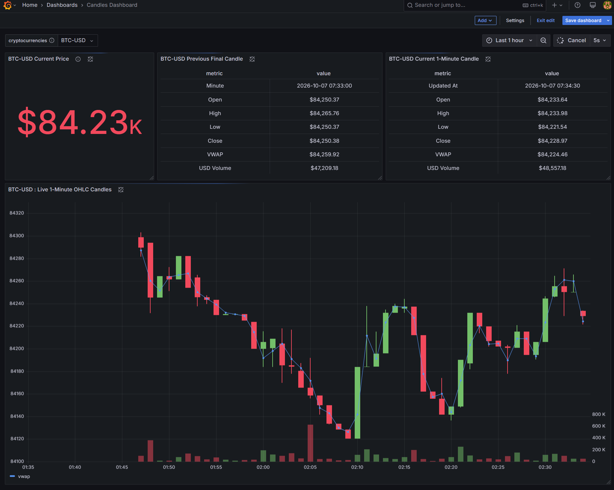
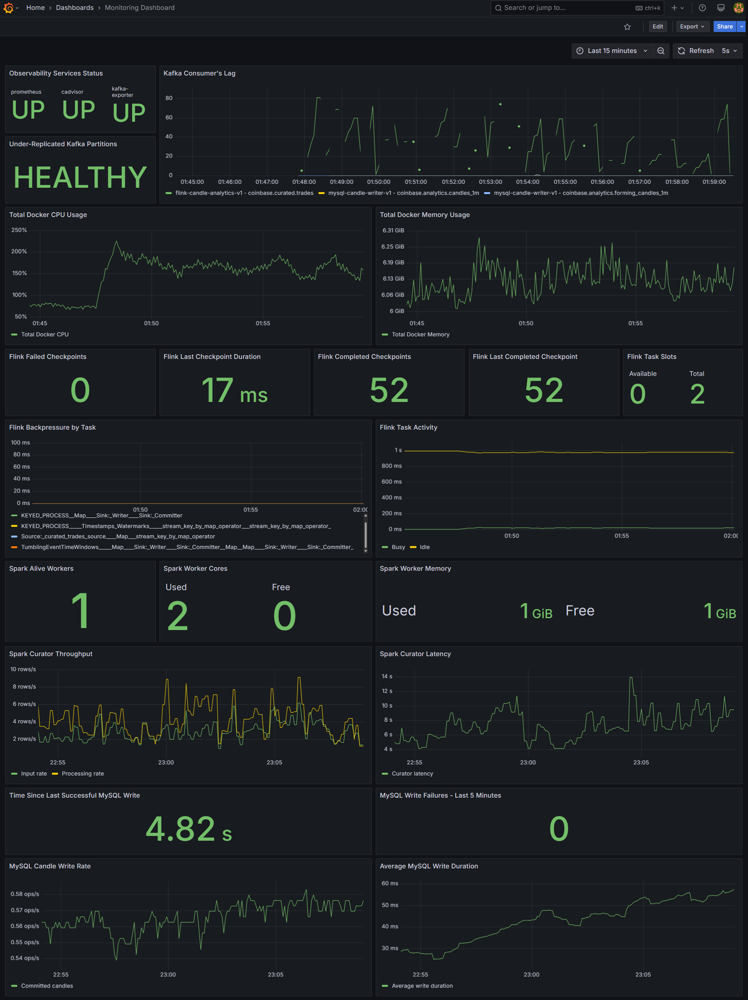

# Real-Time Crypto Market Intelligence Platform

A real-time streaming Data Analytics project that turns Coinbase market-trade events into live market activity, one-minute candle analytics, and operational dashboards.

The pipeline ingests live trades, validates and transforms them, creates event-time OHLC candles, stores the results in MySQL, and visualizes market activity and pipeline health in Grafana.

## Market Dashboard



## Monitoring Dashboard



## Requirements

- Docker Desktop with Docker Compose
- Python 3.10+
- A Python virtual environment for the ingestion listener
- A `.env` file containing the MySQL configuration required by Docker Compose

## Run the Project

After cloning the repository and configuring `.env`, open two terminals from the project root.

### 1. Start the infrastructure

```powershell
docker compose --env-file .env -f infra/docker/docker-compose.yml -f infra/docker/docker-compose.spark.yml -f infra/docker/docker-compose.flink.yml -f infra/docker/docker-compose.mysql.yml -f infra/docker/docker-compose.grafana.yml -f infra/docker/docker-compose.observability.yml up -d
```

### 2. Activate the Python environment

```powershell
.\venvironment\Scripts\Activate.ps1
```

### 3. Start live Coinbase ingestion

```powershell
python services/ingestion/coinbase_trade_listener.py --product BTC-USD --print-raw
```

You can run the ingestion listener in separate terminals for any product supported by the Coinbase market-trades WebSocket.

```powershell
python services/ingestion/coinbase_trade_listener.py --product ETH-USD --print-raw
python services/ingestion/coinbase_trade_listener.py --product SOL-USD --print-raw
```

## View Grafana

Open:

```text
http://localhost:3000
```

Then open:

- **Candles Dashboard** for live market analytics
- **Monitoring Dashboard** for Kafka, Spark, Flink, Docker, and MySQL health
